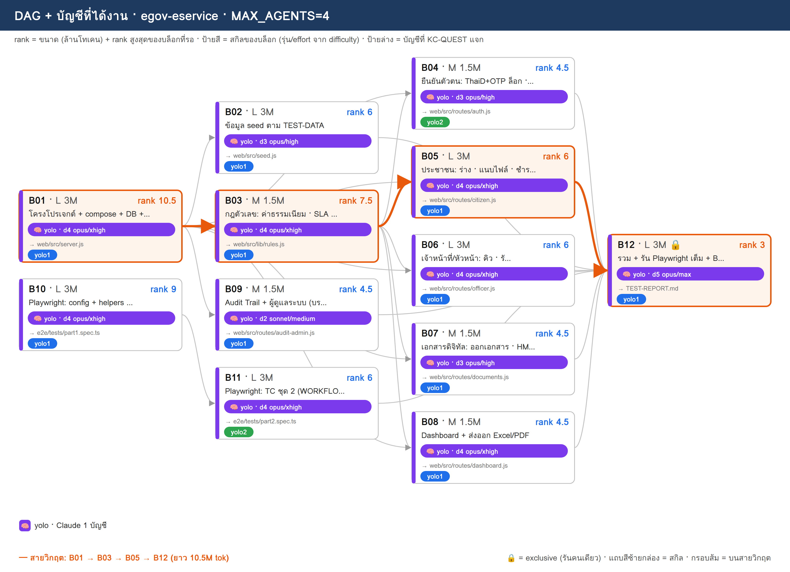
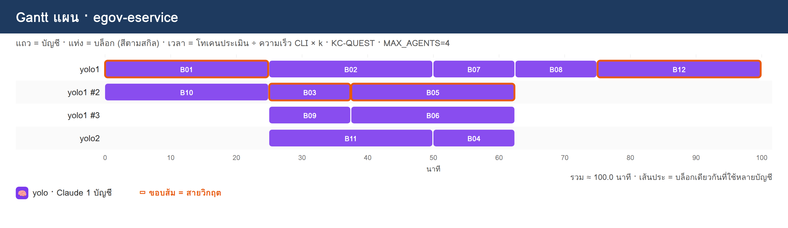

# PLAN · egov-eservice

**โจทย์:** สร้างเว็บ e-Service กลาง เทศบาลนครตัวอย่าง ตามชุดโจทย์ใน /workspace/egov-brief (อ่าน README.md ก่อน) ทำตาม REQUIREMENTS.md CONTRACT.md TEST-DATA.md DECISIONS.md ครบทุกข้อ (ห้ามแก้ไฟล์ใน /workspace/egov-brief) · stack: Node.js 20 + Express + SQLite (better-sqlite3) + หน้า server-rendered · รันด้วย `docker compose up --build` คำสั่งเดียว (โฟลเดอร์ web/) · รองรับ TEST_MODE=1 และ BUG_MODE ตาม BUGS.md · มีชุด Playwright (โฟลเดอร์ e2e/) ครบทุก TC ใน TEST-PLAN.md · ข้อความ/testid/route/API ต้องตรง CONTRACT ตรงตัวอักษร · กฎเวลาทุกข้ออ่านจากนาฬิกาทดสอบ (web/src/lib/clock.js) เท่านั้น · บั๊กแต่ละตัวเปิดด้วย bug('Bxx') จาก web/src/lib/bugs.js ในโค้ดของบล็อกที่ดูแลกฎนั้น

วางแผนเมื่อ 13/11/2026 14:45 · MAX_AGENTS 4 · บัญชี yolo1, yolo2 · ตัวปรับเวลา k (ยังไม่มี calib.json → k=1)

> แผนนี้ยังไม่ได้รันจริง — KC-QUEST เลือกบัญชีจากโควตา แล้วจำลองเวลาตาม dependency

## 1) โควตาของแต่ละบัญชี

| บัญชี | แพลน | ใช้ไป 5 ชม. | ใช้ไปสัปดาห์ | headroom | รีเซ็ต/หมดอายุ (ชม.) | U | slot | ที่มา |
|---|---|---|---|---|---|---|---|---|
| yolo1 | default | 6% | 50% | **50%** | 42.2 | 0.362 | 3 | team.py quota |
| yolo2 | default | 0% | 0% | **100%** | 164.2 | 0.127 | 3 | team.py quota |

## 2) DAG + สกิล + บัญชี

**สายวิกฤต:** B01 → B03 → B05 → B12 · ยาว 10.5M tok

## 3) ตารางแจกงาน (เหตุผล KC-QUEST ทุกบล็อก)

| บล็อก | สกิล | ชื่อ | ขนาด · c | รอ | rank | บัญชี (บทบาท) | เริ่ม–จบ (นาที) | เหตุผล KC-QUEST |
|---|---|---|---|---|---|---|---|---|
| **B01** | 🧠 yolo | โครงโปรเจกต์ + compose + DB + test hook | L · 3 | – | 10.5 | yolo1 (ทำ) | 0.0–25.0 | ทำ: yolo1 42.9 (U=0.363 F=0.02 S=0.862 S=1.0 L=0.0) · 3.00M ≈ 5ชม. 7.8% / สัปดาห์ 0.98% · อันดับ 2 yolo2 34.2 |
| B10 | 🧠 yolo | Playwright: config + helpers + TC ชุด 1 (AUTH FEE SUBMIT UPLOAD PAY QUEUE SLA NOTI) | L · 3 | – | 9 | yolo1 (ทำ) | 0.0–25.0 | ทำ: yolo1 36.2 (U=0.363 F=0.02 S=0.784 S=0.857 L=0.333) · 3.00M ≈ 5ชม. 7.8% / สัปดาห์ 0.98% · อันดับ 2 yolo2 32.0 |
| **B03** | 🧠 yolo | กฎตัวเลข: ค่าธรรมเนียม · SLA วันทำการ · ระดับเตือน · อายุเอกสาร | M · 1.5 | B01 | 7.5 | yolo1 (ทำ) | 25.0–37.5 | ทำ: yolo1 36.6 (U=0.363 F=0.01 S=0.745 S=0.714 L=0.0) · 1.50M ≈ 5ชม. 3.9% / สัปดาห์ 0.49% · อันดับ 2 yolo2 30.3 |
| B02 | 🧠 yolo | ข้อมูล seed ตาม TEST-DATA | L · 3 | B01 | 6 | yolo1 (ทำ) | 25.0–50.0 | ทำ: yolo1 30.2 (U=0.363 F=0.021 S=0.667 S=0.571 L=0.333) · 3.00M ≈ 5ชม. 7.8% / สัปดาห์ 0.98% · อันดับ 2 yolo2 27.7 |
| B11 | 🧠 yolo | Playwright: TC ชุด 2 (WORKFLOW DOC PDPA DASH AUDIT RBAC NFR) | L · 3 | B10 | 6 | yolo2 (ทำ) | 25.0–50.0 | ทำ: yolo2 27.7 (U=0.128 F=0.01 S=0.922 S=0.571 L=0.0) · 3.00M ≈ 5ชม. 7.8% / สัปดาห์ 0.98% · อันดับ 2 yolo1 25.7 |
| B09 | 🧠 yolo | Audit Trail + ผู้ดูแลระบบ (บริการ · วันหยุด · ผู้ใช้) | M · 1.5 | B01 | 4.5 | yolo1 (ทำ) | 25.0–37.5 | ทำ: yolo1 23.9 (U=0.363 F=0.01 S=0.628 S=0.429 L=0.667) · 1.50M ≈ 5ชม. 3.9% / สัปดาห์ 0.49% · อันดับ 2 yolo2 21.6 |
| **B05** | 🧠 yolo | ประชาชน: ร่าง · แนบไฟล์ · ชำระ QR · เลขคำขอ · ยกเลิก/ส่งแก้ | L · 3 | B01, B03 | 6 | yolo1 (ทำ) | 37.5–62.5 | ทำ: yolo1 28.4 (U=0.363 F=0.021 S=0.55 S=0.571 L=0.333) · 3.00M ≈ 5ชม. 7.8% / สัปดาห์ 0.98% · อันดับ 2 yolo2 23.2 |
| B06 | 🧠 yolo | เจ้าหน้าที่/หัวหน้า: คิว · รับเรื่อง · ตีกลับ · ส่งต่อ · อนุมัติ · แจ้งเตือน | L · 3 | B01, B03 | 6 | yolo1 (ทำ) | 37.5–62.5 | ทำ: yolo1 23.9 (U=0.363 F=0.022 S=0.472 S=0.571 L=0.667) · 3.00M ≈ 5ชม. 7.8% / สัปดาห์ 0.98% · อันดับ 2 yolo2 23.2 |
| B04 | 🧠 yolo | ยืนยันตัวตน: ThaiD+OTP ล็อก · ลงทะเบียน · SSO เจ้าหน้าที่ | M · 1.5 | B01, B03 | 4.5 | yolo2 (ทำ) | 50.0–62.5 | ทำ: yolo2 24.9 (U=0.128 F=0.005 S=0.883 S=0.429 L=0.0) · 1.50M ≈ 5ชม. 3.9% / สัปดาห์ 0.49% · อันดับ 2 yolo1 21.0 |
| B07 | 🧠 yolo | เอกสารดิจิทัล: ออกเอกสาร · HMAC · PDF · /verify · unmask · ไฟล์แนบ | M · 1.5 | B01, B03 | 4.5 | yolo1 (ทำ) | 50.0–62.5 | ทำ: yolo1 21.0 (U=0.363 F=0.011 S=0.433 S=0.429 L=0.667) · 1.50M ≈ 5ชม. 3.9% / สัปดาห์ 0.49% · อันดับ 2 yolo2 21.0 |
| B08 | 🧠 yolo | Dashboard + ส่งออก Excel/PDF | M · 1.5 | B01, B03 | 4.5 | yolo1 (ทำ) | 62.5–75.0 | ทำ: yolo1 27.1 (U=0.363 F=0.011 S=0.394 S=0.429 L=0.0) · 1.50M ≈ 5ชม. 3.9% / สัปดาห์ 0.49% · อันดับ 2 yolo2 24.3 |
| **B12** | 🧠 yolo | รวม + รัน Playwright เต็ม + BUG_MODE B01–B12 | L · 3 | B02, B04, B05, B06, B07, B08, B09, B11 | 3 | yolo1 (ทำ) | 75.0–100.0 | ทำ: yolo1 24.0 (U=0.363 F=0.023 S=0.316 S=0.286 L=0.0) · 3.00M ≈ 5ชม. 7.8% / สัปดาห์ 0.98% · อันดับ 2 yolo2 21.7 |

## 4) Gantt แผน

## 5) รอบแจกงาน

| นาทีที่ | บล็อกที่เริ่ม |
|---|---|
| 0 | B01→yolo1, B10→yolo1 |
| 25 | B03→yolo1, B02→yolo1, B11→yolo2, B09→yolo1 |
| 37.5 | B05→yolo1, B06→yolo1 |
| 50 | B04→yolo2, B07→yolo1 |
| 62.5 | B08→yolo1 |
| 75 | B12→yolo1 |

## 6) สรุป

- บล็อก 12 · แจกได้ 12 · agent พร้อมกันสูงสุด 4/4
- เวลาประมาณ 100.0 นาที (แท่ง Gantt) · ไฟล์ผลของทีม: `/workspace/plans/egov-eservice/app/`

ต่อไป: `dagplan.py export egov-eservice` → `dagplan.py run egov-eservice` → `dagplan.py report egov-eservice`
