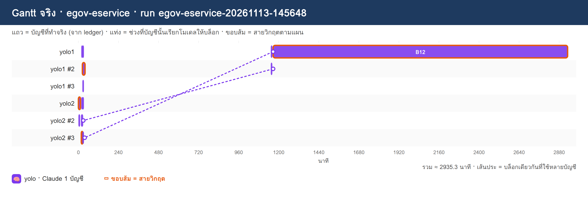
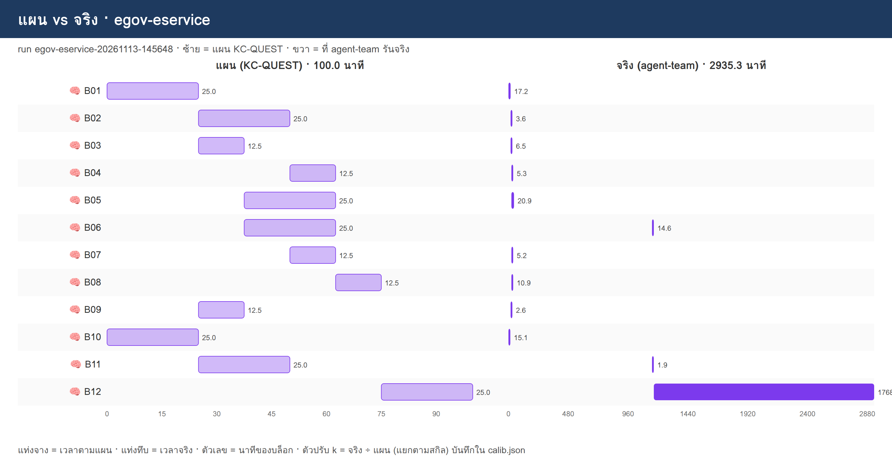

# REPORT · egov-eservice

**run:** `egov-eservice-20261113-145648` · `/workspace/.agent-team/egov-eservice-20261113-145648` · โจทย์: สร้างเว็บ e-Service กลาง เทศบาลนครตัวอย่าง ตามชุดโจทย์ใน /workspace/egov-brief (อ่าน README.md ก่อน) ทำตาม REQUIREMENTS.md CONTRACT.md TEST-DATA.md DECISIONS.md ครบทุกข้อ (ห้ามแก้ไฟล์ใน /workspace/egov-brief) · stack: Node.js 20 + Express + SQLite (better-sqlite3) + หน้า server-rendered · รันด้วย `docker compose up --build` คำสั่งเดียว (โฟลเดอร์ web/) · รองรับ TEST_MODE=1 และ BUG_MODE ตาม BUGS.md · มีชุด Playwright (โฟลเดอร์ e2e/) ครบทุก TC ใน TEST-PLAN.md · ข้อความ/testid/route/API ต้องตรง CONTRACT ตรงตัวอักษร · กฎเวลาทุกข้ออ่านจากนาฬิกาทดสอบ (web/src/lib/clock.js) เท่านั้น · บั๊กแต่ละตัวเปิดด้วย bug('Bxx') จาก web/src/lib/bugs.js ในโค้ดของบล็อกที่ดูแลกฎนั้น

## ตารางบล็อก (แผน vs จริง)

| บล็อก | สกิล | บัญชีแผน | บัญชีจริง | นาทีแผน | นาทีจริง | tokens (ไม่รวม cache read) | ครั้ง | สถานะ | ไฟล์ผล |
|---|---|---|---|---|---|---|---|---|---|
| **B01** | 🧠 yolo | yolo1(ทำ) | yolo2(ทำ) | 25.00 | 17.22 | 312,427 | 1 | ok | ✅ web/src/server.js |
| B02 | 🧠 yolo | yolo1(ทำ) | yolo2(ทำ) | 25.00 | 3.63 | 127,226 | 1 | ok | ✅ web/src/seed.js |
| **B03** | 🧠 yolo | yolo1(ทำ) | yolo2(ทำ) | 12.50 | 6.52 | 203,383 | 1 | ok | ✅ web/src/lib/rules.js |
| B04 | 🧠 yolo | yolo2(ทำ) | yolo1(ทำ) | 12.50 | 5.28 | 146,430 | 1 | ok | ✅ web/src/routes/auth.js |
| **B05** | 🧠 yolo | yolo1(ทำ) | yolo1(ทำ) | 25.00 | 20.87 | 452,077 | 1 | ok | ✅ web/src/routes/citizen.js |
| B06 | 🧠 yolo | yolo1(ทำ) | yolo2(ทำ), yolo1(ทำ) | 25.00 | 14.57 | 634,212 | 2 | ok | ✅ web/src/routes/officer.js |
| B07 | 🧠 yolo | yolo2(ทำ) | yolo2(ทำ) | 12.50 | 5.20 | 166,965 | 1 | ok | ✅ web/src/routes/documents.js |
| B08 | 🧠 yolo | yolo1(ทำ) | yolo1(ทำ) | 12.50 | 10.87 | 237,114 | 1 | ok | ✅ web/src/routes/dashboard.js |
| B09 | 🧠 yolo | yolo1(ทำ) | yolo1(ทำ) | 12.50 | 2.65 | 125,472 | 1 | ok | ✅ web/src/routes/audit-admin.js |
| B10 | 🧠 yolo | yolo1(ทำ) | yolo2(ทำ) | 25.00 | 15.10 | 329,222 | 1 | ok | ✅ e2e/tests/part1.spec.ts |
| B11 | 🧠 yolo | yolo2(ทำ) | yolo2(ทำ), yolo1(ทำ) | 25.00 | 1.92 | 473,490 | 2 | ok | ✅ e2e/tests/part2.spec.ts |
| **B12** | 🧠 yolo | yolo1(ทำ) | yolo1(ทำ) | 25.00 | 1768.45 | 1,674,558 | 1 | ok | ✅ TEST-REPORT.md |

- tokens รวมของบล็อก **4,882,576** = ผลรวมจาก ledger ของ run (14 การเรียก) **4,882,576** ✅ ตรงกัน
- การเรียกที่ไม่ใช่บล็อก (ตรวจความพร้อม ฯลฯ): 0 ครั้ง · 0 tokens (ไม่นับในตาราง)
- เวลารวม: แผน 100.0 นาที · จริง 2935.3 นาที
- บล็อกเสร็จ 12/12

## ภาพ

## ความต่างระหว่างแผนกับของจริง

- B01: แผน yolo1(ทำ) → จริง yolo2(ทำ)
- B02: แผน yolo1(ทำ) → จริง yolo2(ทำ)
- B03: แผน yolo1(ทำ) → จริง yolo2(ทำ)
- B04: แผน yolo2(ทำ) → จริง yolo1(ทำ)
- B06: แผน yolo1(ทำ) → จริง yolo2(ทำ), yolo1(ทำ)
- B10: แผน yolo1(ทำ) → จริง yolo2(ทำ)
- B11: แผน yolo2(ทำ) → จริง yolo2(ทำ), yolo1(ทำ)
- (export ส่งเป็นฝั่ง yolo/cyolo ไม่ผูกบัญชี เพื่อให้ failover ของ agent-team ทำงาน → agent-team เลือกบัญชีในฝั่งเองตามโหลด/โควตา ดู references/run.md)
- event worker_stop:  → โควตา 99% ≥ เกณฑ์ 80%
- event worker_switch: B12 yolo2→yolo1 บัญชี yolo2 หยุดรับงาน: โควตา 99% ≥ เกณฑ์ 80%
- event worker_stop:  → โควตา 90% ≥ เกณฑ์ 80%

## ตัวปรับเวลา k (calib.json)

`/workspace/plans/calib.json`: {"yolo": 7.8831}

k = นาทีจริง ÷ นาทีแผน (ก่อนคูณ k) แยกตามสกิล · `plan` ครั้งถัดไปคูณเวลาแต่ละบล็อกด้วย k ของสกิลนั้น
